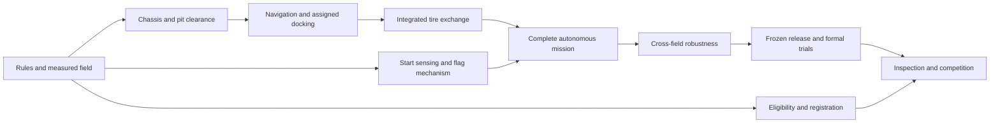

# Backcasting from winning in 2027

> **Historical plan:** V2 scoring and dates below are superseded or past. Review `CURRENT-RULES-2026-10-29.md` before using these targets; team progress has not been established.

Prepared October 8, 2026. Competition identity remains a working assumption; dates and governing sources are in [RULES-AND-SOURCES.md](RULES-AND-SOURCES.md).

## Define the outcome first

The terminal outcome is **official first place in the team's chosen category** on April 17, 2027. A fast demonstration in the lab is insufficient: the team must be eligible, inspected, ranked well enough to advance, and score better than opponents in the decisive rounds.

We cannot establish the eventual winning score or guarantee a win today. Use two separate measures:

- **Competitive outcome:** official placement and actual scores versus opponents.
- **Readiness evidence:** legal configuration, all scoring tasks demonstrated, score distribution, mission time, and reproducibility under randomized conditions.

Under the V2 tournament model, seek a **top-six qualifying rank** to avoid the play-in route. Qualifiers use the best of three runs; the remaining runs can break ties. After direct qualification, an eight-team elimination bracket requires three successive wins. Confirm the format for the chosen category and any later revision before using it as a match plan.

## What a winning attempt must demonstrate

These are proposed engineering gates, not IEEE rules. Revise numerical targets after the first integrated trials; preserve adequate testing time.

| Measure | Proposed acceptance target | Why it matters |
|---|---|---|
| Legality and logistics | All intended configurations inspected in rehearsal; eligibility, registrations, transport and lodging resolved | An unentered or illegal robot cannot win |
| Task coverage | Every robot scoring task completed and independently scored from video | An incomplete mission leaves large points available to opponents |
| Score consistency | Complete fixed robot-task score in formal acceptance runs; publicity logged separately until confirmed | Exposes losses hidden by a single best run |
| Timing | Full mission, including final parking, P95 at or below 150 s; every acceptance run at or below 170 s | Leaves margin within the current 180 s match |
| Evidence floor | 100/100 successful randomized full missions on the frozen configuration | Gives a useful, bounded reliability claim |
| Championship stretch | 300/300 successful full missions if capacity supports it | Raises confidence for successive elimination rounds |
| Environmental robustness | Independent field construction, all assigned spots, varied legal obstacle positions, batteries, lighting and starts | Avoids dependence on one familiar board |
| Recovery | Restore a released spare or backup configuration and complete three missions within 30 min in a drill | Makes a repair capability observable |

A successful acceptance run must meet every declared scoring task, have no illegal interaction or early start, avoid contacts that lose clean-lap credit, and finish within the engineering time limit. Record all attempts. If a run fails, investigate and retain it in that configuration's dataset; do not erase it by selecting a later streak. Changes that affect performance require new evidence for the affected gates.

For zero failures in n independent trials, the one-sided 95% exact lower confidence bound for success probability is `0.05^(1/n)`: 100/100 supports about **97.05%**, while 300/300 supports about **99.01%**. These claims cover the sampled conditions; repeated easy layouts or correlated failures do not establish venue-wide reliability. With actual failures, calculate an exact binomial bound on the entire configuration-specific dataset and document the result.

Illustratively, independent 95% per-run reliability yields `0.95^3 = 85.7%` probability of three clean elimination runs; 99% yields `0.99^3 = 97.0%`. Clean runs still may lose to a higher-scoring opponent. Shared lighting, board construction, or sensor failure can make the independence assumption false.

## Work backward through the gates

Each row asks: **what must already be true for the next row above it to succeed?** Dates are team deadlines unless labeled official.

| Deadline | Required state and evidence | Must already exist | If the gate is missed |
|---|---|---|---|
| **Apr 17 — competition, official** | Legal release scores competitively in qualifiers and successive eliminations; technician follows rehearsed procedure | Verified event procedures, inspected release, charged batteries, clear task/score evidence | Use the proven inspected configuration; diagnose only between permitted access windows |
| **Apr 15 noon — hardware room, official** | Check in, inspect and validate venue operation during allotted practice | Travel complete; configuration manifest; calibration and emergency-stop drill | Correct environment-specific defects and reinspect significant changes |
| **Apr 8 — departure readiness** | Robot, matching spares, tools, field references, offline documentation and releases packed; restoration drill passed | Acceptance candidate and spare parts already qualified | Spend remaining time on reliability and operational failures |
| **Apr 1 — acceptance review** | At least the evidence floor, stress coverage, and documented unresolved issues; stretch target pursued if feasible | Frozen configuration with capacity for repeated trials since early March | Repair, retest affected evidence, and state the actual confidence level; preserve tested fallback |
| **Mar 18 — operational rehearsal** | Mock qualifier/play-in/elimination day, simulated sequestration, two-minute preparation and repair drill | Released software and hardware, technician checklist, explicit battery policy | Fix operational causes and repeat the affected rehearsal |
| **Mar 4 — performance feature freeze** | Full-score candidate selected from matched trials; speed improvements stop unless required by evidence | Complete mission, cross-field data, qualified mechanisms and baseline release | Keep the strongest proven configuration; prioritize missing points and failure removal |
| **Mar 1 — registration closes, official** | Correct category and participants registered; documentation retained | Eligibility and funding resolved; registration completed by internal Feb 15 deadline | Escalate immediately to team lead; organizer acceptance cannot be assumed |
| **Feb 18 — robustness gate** | All assigned spots and legal layouts tested; independent field run; complete cold-start mission repeatable | Integrated robot, calibrated perception, mission logs and randomized test method | Address the dominant failure before adding speed |
| **Jan 28 — full-score baseline** | All robot-task points demonstrated on 20 logged full runs; failures categorized | Full mission and tire/flag mechanisms working | Allocate the next sprint to the largest measured point losses |
| **Jan 14 — latest full-mission integration** | End-to-end autonomous mission from legal start through final park on a physical field | Stable navigation, pit exchange, lap tracking, flag timing and finish logic | Declare schedule risk; stop peripheral development and integrate daily |
| **Dec 17 — early integrated baseline** | Complete mission demonstrated before the holiday/exam interruption; backup saved | Dec 3 integrated subsystems | Jan 14 is the recovery deadline, not an extension of the final freeze |
| **Dec 3 — integrated alpha** | Navigation, assigned stop, tire exchange, start sensing and flag control run together | Critical mechanisms and their interfaces validated | Simplify mechanism and software interfaces; retain all high-value tasks |
| **Nov 12 — risk retirement and design selection** | Chassis choice supported by measured turn clearance, grip, stop precision and exchange reliability | Usable field and bench prototypes; candidate comparison | Select the feasible conventional architecture and document its limits |
| **Oct 22 — field and requirements** | Practice field usable; rule-to-test matrix complete; preliminary budget and lead times known | Oct 15 decision package and lab access | Build priority field sections first; settle geometry before irreversible chassis choices |
| **Oct 15 — first decision package** | Competition/category confirmed; roles and weekly availability named; Q&A issues logged; inventory and funding cap known; pit/tire bench experiment started | Actions below begin today | Track missing information explicitly and advance independent physical experiments |

There are 189 days from October 8 to the April 15 opening. The schedule deliberately seeks integration before January, rather than allocating most of the remaining season to separate subsystems.

## Critical path and parallel work

Start tire-handling experiments while the field and drivetrain are being built. Do not wait for a finished robot to discover an unreliable pickup or a pit space that cannot fit the mechanism. Registration and publicity run in parallel and must not consume the controls team's final testing time.

## Choose by scoring value and evidence

Use the verified score table in [RULES-AND-SOURCES.md](RULES-AND-SOURCES.md), rather than last season's scoring or an older web summary.

V2 assigns one point per full ten seconds saved. Saving thirty seconds earns three points. A fresh-tire pickup is worth forty; three clean laps offer seventy-five. Consequently, the initial architecture should favor repeatable docking, contact avoidance and simple tire manipulation.

For a proposed faster strategy, estimate `expected score change = expected extra points - expected points newly lost`. For example, a three-point speed gain is erased by an additional 7.5 percentage points of failure on a forty-point task, or roughly 0.85 percentage points of additional risk of losing a nominal 355-point run. These examples are tradeoff calculations, not measured robot probabilities. Elimination survival and the lower tail of scores matter alongside the average.

Use randomized, paired baseline/candidate trials on the same layouts. Compare complete-task rate, contacts, early starts, worst scores, P10 score, and P95 full-mission time. Promote a change only when it improves the relevant competitive objective without violating legality or reliability gates. A small trial cannot resolve a tiny difference in rare failure probability; keep the stable configuration when evidence is inconclusive.

## Provisional architecture

Evaluate a conventional encoder-equipped differential drivetrain first, with a compact tire-exchange mechanism and separate onboard mission and motor-control responsibilities. This is a hypothesis to test, not a committed bill of materials. Compare a steering drivetrain only if measured tire scrub, steering geometry, or clearance makes it advantageous.

Respect the unusual **minimum lower-body size** as well as the maximum starting cube. Measure turning swept volume with the tire payload and deployed flag. Select the footprint only after consulting the official guide/CAD and testing pit access.

Use feedback from field-relative features, encoders, and measured obstacle clearance; timed motion alone is unlikely to cover construction variation. Perception must read the official AprilTag assignments and detect the referee start reliably. Camera exposure, range sensing, and feature choice are experiments. Keep sensing mounts adjustable for the announced start-flag relocation.

A provisional mission is: armed and still → legal start → observe assignment → lap 1 → assigned pit dock → stationary dwell with margin above two seconds → drop carried tire and collect a different tire → lap 2 → final lap and raise school flag → finish crossing → assigned final park → safe idle. Verify dwell, tire-credit timing and post-finish parking interpretation through official Q&A before treating this sequence as settled. Maintain a separate lap counter and explicit state transitions so a noisy observation cannot duplicate a task or deploy the flag on the wrong lap.

## Resource assumptions and contingency

Planning basis: 4–6 contributors sharing mechanical/electrical, autonomy, integration/testing, and team/logistics responsibilities, with **24–40 combined engineering hours per week** and regular physical field access. These are assumed capacities; no team or budget has been established. Allow reduced work around exams and December 18–January 3.

By October 15, write down actual weekly availability, existing parts/tools, procurement ceiling, field/storage access, advisor and travel support. Quote the field, robot, duplicate failure-prone parts, consumables, memberships, event registration and travel separately. Reserve at least 20% of the engineering budget for replacements and contingencies; this is a planning allowance, not a market estimate.

If capacity is below the assumption, use available controllers and standard fabrication, reduce architectural novelty, combine roles, and preserve the complete-mission objective. Prioritize mandatory legality, high-value tasks, and field testing. Missing Jan 14 integration or Mar 4 freeze is a competitive risk requiring scope simplification and reallocation; it cannot be repaired by claiming confidence from fewer demos.

For a rule revision, compare official text against the ledger within 48 hours of discovery, change the score model and tests, and revisit priorities. Preview obstacle counts should be tested now when feasible; preview scoring must remain a scenario until published. Weekly checks are a team process described in this plan, not an automated service.

## October 8–15: immediate work

| Action | Responsible role to assign | Deliverable |
|---|---|---|
| Confirm competition, category, school and current build status | Team lead | One-paragraph charter and actual resources |
| Review both V2 manuals and obtain official Q&A history | Rules/integration lead | Rule ledger; unresolved questions with official answers where available |
| Inspect guide/CAD, mark legal minimum/maximum robot envelope and pit geometry | Mechanical lead | Dimensioned field/chassis sketch and turn-clearance estimate |
| Prototype tire drop and distinct fresh-tire pickup with actual game-element geometry | Mechanical + controls | Video and 20 bench trials recording failures and cycle times |
| Validate assigned AprilTag reading and start sensing across lighting conditions | Autonomy lead | Logged readings, detection latency and false-trigger observations |
| Inventory parts, obtain quotes, reserve lab slots and secure field storage | Team/logistics lead | Budget cap, lead times and recurring work schedule |
| Establish a baseline run record and weekly gate review | Test lead | First evidence log and an owned next sprint |

Review the first evidence package on October 15. The next sprint is driven by the largest unresolved threat to the complete mission.
