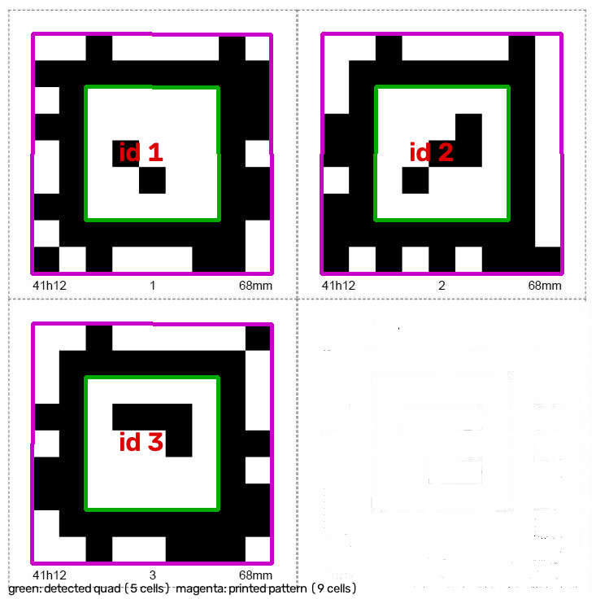
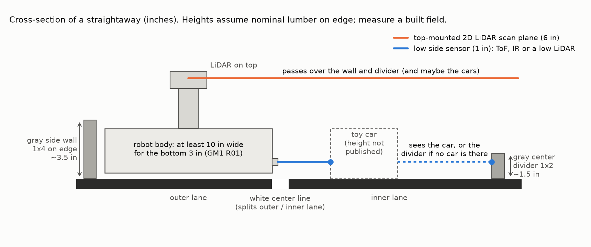

# Concept input for §4.1 "Questions for Machine Design" — updated to the V3 game manuals

*Draft for team discussion, October 31, 2026.* A contribution to the "What / How" table in our concept document (pages 5–8 of the October 21 handout). Prepared with AI assistance (Anthropic's Claude) from the organizer's manuals. Results marked **agent-run** are calculations and simulations, not measurements. Check anything important against the manuals before relying on it.

**Sources.** Game Manual 1 V3.0 (revision dated 9/18/2026) and Game Manual 2 V3.0 (revisions dated 9/18 and 10/4/2026), downloaded from ieeesoutheastcon.org on 10/29/2026 and confirmed unchanged on 10/31/2026. Also used: the June 2026 arena build guide, and the organizer's AprilTag sheet and tire model. Official Q&A on Discord outranks the manuals (GM1 C00) and was **not** reviewed for this draft.

## The short version

1. **Our handout uses the Rev 2.0 (6/15/2026) manuals. V3 changed the scoring.**
    - The "enter pit +15", "correct pit +15" and "wait 2 s or −5" rows no longer exist.
    - The tire exchange now pays by box: red drop 25 (assigned box) or 12 (other); blue pickup 40 or 20.
    - Clean laps pay more: 15 per lap for walls, 25 per lap for obstacles, and there are 3 obstacles instead of 2.
    - Finishing under 2:45 adds a flat 30 points.
2. **The field is made for line sensing.** The floor is black. The octagon "center line", the pit boxes and the start/finish area are white. The walls and the center divider are gray.
3. **A LiDAR on top of the robot will probably see nothing on the field.** The walls are about 3.5 in tall and the center divider about 1.5 in, so the sensors that see them must sit low.
4. **The AprilTag family is tagStandard41h12, and OpenCV's ArUco module cannot read it.** Use the AprilTag 3 library.
5. **The rules answer several questions in our margins.**
    - Infrared ToF/LiDAR is not banned; only visible-light lasers are.
    - No radio to the pit or to field objects.
    - No self-driving garage: the game allows one Robot unit.
    - A camera mast may extend after the start.
6. **Qualification counts only our best of three matches.** Attempting the full mission in qualification is usually right, even with a real chance of stalling in the pit.
7. **Judging is separate from match points.** It is based on a 5-page Engineering Portfolio and a 10-minute interview, and every member should be able to explain the design.

## 1. What changed between our handout (Rev 2.0) and V3

| Scoring item | Rev 2.0 (our table) | V3 (current) |
|---|---|---|
| Enter the course | 25 | 25 |
| Finish 3 laps in ≤ 3:00 | 100 | 100 |
| Speed bonus | 1 point per full 10 s under 3:00 | 30 if under 2:45 (strictly less) |
| Start on the green flag | 10 | 10. An early start loses the 10, costs −2 and earns a Yellow Card |
| Pit stop after lap 1 or 2 | 15 (only 10 if the robot leaves in < 2 s) | Removed: replaced by the tire exchange |
| Stop in the AprilTag pit area | 15 | Removed |
| Drop a tire | 25 | Red tire: 25 in the assigned box, 12 anywhere else |
| Pick up a fresh tire | 40 | A different blue tire: 40 from the assigned box, 20 from elsewhere. The points are lost if it is dropped before the finish line |
| End in the AprilTag box | 15 | 15 (more than 75% of the robot inside) |
| No gray-wall contact | 10 per lap | 15 per lap |
| No obstacle contact | 15 per lap, 2 obstacles | 25 per lap, 3 obstacles |
| School flag on the final lap | 25 | 25 |
| Publicity contest | 10 | 10 |

The V3 maximum is **390 robot points, plus 10 for publicity**. Finishing, the time bonus and clean laps make up 250 of the 390. The tire exchange is 65. Start, entry, flag and parking add up to 75.

Other V3 changes:

- The center divider is now a 1×2 (it was a 1×1).
- New Appendix E sets out the obstacle quadrants, and new Appendix G sets out the pit-stop challenge.
- Start-flag operation is still a placeholder: Appendix F says "details will be provided in Version 3.1".

GM1 barely changed. The final match moves to the Awards Banquet, and the sentence "The Robot may not contract this portion at any time" was dropped from the 10 × 10 in minimum-size rule.

## 2. Our table, row by row

Each row keeps the team's ideas and adds notes. GM1 and GM2 are the two game manuals.

### Start on the green flag — 10 points

**Team ideas:** detect the flag's color (RGB) with a camera and wait about 1 s after detection to avoid early starts; enter coordinates to start at a near-perfect distance (B).

**Added:**

- The referee **raises** the flag to start: GM2 §3.4.2 says "FLAG DOWN → REFEREE RAISES FLAG → MATCH/TIMER START", although §3.1 says "lowered". Appendix F is still a placeholder, so keep the detector easy to change.
- The flag is on the wall tower between the pit area and the racecourse (GM2 §3.3). The AprilTag is on the same wall by the start area, so one camera aimed at that wall from the start box can read the tag and then watch the flag.
- Detect a *change*, not just a color. For example, require green to appear in a region of the image over several consecutive frames. A 1 s wait is legal, but a few frames of confirmation costs almost nothing.
- An early start costs the 10 points, a 2-point penalty and a Yellow Card (G05). A second Yellow Card at the event becomes a Red Card, which zeroes that match (GM1 C03). Err on the side of starting late.
- Fallback: a clearly marked start switch (GM1 R03). It earns 0 flag points, and the robot must stay still for 5 s after the press.

### Read the AprilTag to find our pit box — enables 15 + 25 + 40

**Team ideas:** a QR-code-like reader using the camera; a ROS-based AprilTag library (B).

**Added:**

- There is one tag, ID 1, 2 or 3, chosen by a die roll and "fastened to the wall by the starting area" (GM2 §3.4.1, Appendix G).
- The family is **tagStandard41h12**. An agent-run check decoded the organizer's tag sheet with the AprilTag 3 detector: IDs 1, 2 and 3, with no bit errors and no match in any other family. **OpenCV's ArUco module has no 41h12 dictionary** (checked in OpenCV 5.0.0), so use the AprilTag 3 library: C `apriltag`, Python `pupil-apriltags`, or a ROS wrapper set to `tagStandard41h12`.
- Read the tag while waiting in the start box: the robot is still and about 0.15–0.6 m away. In the agent-run synthetic test with full-resolution detection, a 640×480 camera decoded reliably to about 1.8 m head-on and 1.3 m at 60° off-axis; a 1280×720 camera reached about 3.4 m. The pupil-apriltags default, `quad_decimate=2`, shortened these ranges by about 15–30%. Real optics will do worse, so plan for at least 3 pixels per tag cell (27 px across the printed tag).
- The biggest practical risk is **glare**: the manual recommends laminating the tags (Appendix C). In the synthetic test, a reflection covering 5–10% of the tag usually broke decoding. Vote over several frames and avoid camera angles that mirror the overhead lights.
- If the tag read fails, still do the exchange in a guessed box. A wrong box earns 12 + 20, and the right one (1 chance in 3) earns 25 + 40 + 15: about 48 points on average, against 0 for skipping.
- For distance or pose, the tag size is the inner white square: 5 of the 9 printed cells. If "68 mm" is the full printed width, that is 37.8 mm; measure a real print. Entering 68 mm overestimates distance by 1.8×.
- Don't count on the Technician setting the box number by hand. GM1 defines *Autonomous* as reacting only to sensors and pre-programmed commands, and R19 bars human input to robot decisions. GM2 §3.4.1 does mention the Technician declaring "all settings are selected", so ask in Q&A before building a manual selector.

### Enter the racecourse — 25 points

**Team ideas:** recognize the checkered pattern with the camera; at the start, find the entry checkers and drive forward; maybe compute the start-to-flag distance with ROS.

**Added:**

- The start box, the checkered openings and the walls are all fixed to within ±1 in (GM2 G02). A scripted move using wheel encoders and a gyro will get us to the opening, so the camera doesn't have to find the checkers.
- A downward light sensor sees the black-and-white checker band as the crossing cue.
- Two checkered openings, each about 15 in wide, sit either side of the pit divider. The manuals don't say which ones may be used for entering or leaving the pit; that goes to Q&A.

### Three laps within 3:00 — 100 points; under 2:45 — +30

**Team ideas:** LiDAR to stay away from the black painted walls and obstacles, with PID or something better; LiDAR plus an object-detection library, standard or ROS; look at the Rover's implementation (B); speed up after passing obstacles and plan corners (B).

**Added:**

- **Correction: the walls are gray, not black.** The floor is black (PPG1011-7 Onyx). The walls are gray (PPG1036-2 Winter Chill). The build guide paints the center divider along with the gray walls, so assume that touching the divider also counts as wall contact.
- The octagon "center line" is **white**, about 1 in wide (painted, then masked with 1 in tape: GM2 Appendix B). The pit boxes and the start/finish area are white too.
- The white line splits each straightaway into an outer lane, about 10–11 in from the wall, and an inner lane, about 12–12.5 in to the divider. These widths come from the drawing's callouts, are ±1 in, and depend on how the walls are mounted.
- Nothing in V3 forbids driving on or across the line; only gray-wall and obstacle contact cost points. A white line on a black floor is the cheapest reliable lane reference, read with a reflectance sensor array.
- **Sensor height matters (figure below).** The side walls are about 3.5 in tall, the center divider about 1.5 in and the pit divider about 0.75 in, assuming nominal lumber stood on edge as the build photos suggest; measure a built field. A 2D LiDAR sees one horizontal plane, so on top of the robot it scans over every wall. To see the divider, the scan plane must sit below about 1.5 in. Options:
    - side- and front-facing time-of-flight (ToF) sensors at about 1 in;
    - a LiDAR in a low front slot;
    - a camera angled down at the floor.
- **Speed is not the hard part (agent-run estimate).**
    - The mission path is about 14 m: 3 laps, the pit detour and parking.
    - At 8 in/s with a 15 s pit stop, the whole mission takes about 103 s.
    - About 4.2 in/s of cruising speed still beats 2:45.
    - Spend the effort on accuracy and repeatability.
- **Footprint shape.** The bottom 3 in must be at least 10 × 10 in (GM1 R01), so build it just over 10 in wide. A square 10 × 10 in base sweeps a 14.1 in circle when it spins in place, and turned 20° across a lane it is about 12.8 in wide. Both exceed a 10–11 in lane. A round base about 10 in across is always 10 in wide, if a circle counts as "10 inches long by 10 inches wide"; ask in Q&A.
- Above the 3.5 in walls the robot may be wider, but nothing may reach outside the field perimeter (GM2 S01), and wide upper parts could hit the toy cars.

### Pit stop: drop the red tire — 25 (assigned box) / 12 (other); pick up a different blue tire — 40 / 20

**Team ideas:** rough sketches in the shared Teams files.

**Added:**

- This replaces Rev 2.0's "enter pit +15 / correct pit +15 / wait 2 s" rows.
- The sequence (GM2 Appendix G): after lap 1 or 2, go to the assigned box, drop the preloaded red tire, pick up a *different* blue tire, leave, and **keep the blue tire to the finish line**. Dropping it before the line forfeits the 40 or 20.
- "The robot itself does not have to enter the assigned pit box" (Appendix G), so a reach-in mechanism fits that sentence. The same appendix's sequence line says "enter assigned Pit Box", though, so ask in Q&A.
- The red tire must be preloaded **within the 12 in starting cube** (Appendix G cites R01). GM1's general allowance for game elements sticking out of the starting size does not apply here.
- The tire is TPU, 68.2 mm across, with a 40.3 mm bore, and 27.6 mm thick (organizer STL; the caliper photos agree). The manuals don't say how it sits in the box; design for lying flat with the bore facing up, and ask.
- Pit after **lap 2**. A stall in the pit then costs one lap instead of two, and the blue tire only has to be carried for one lap.
- Give the exchange a time budget (about 20 s) and a bail-out: if the pickup fails, leave and finish the laps. A stuck robot loses far more than 65 points.

### Re-enter the racecourse

**Team ideas:** reuse the initial-entrance algorithm, together with the robot knowing the pit stop is complete (B).

**Added:** use the same scripted move, in reverse. The mission state machine knows it is leaving the pit. Which opening is legal for leaving the pit is a Q&A item.

### No obstacle contact — 25 per lap; no gray-wall contact — 15 per lap

**Team ideas:** LiDAR to stay away from the walls and obstacles, with PID; the same detection algorithm for avoiding obstacles (B).

**Added:**

- Clean laps are worth 120 of the 390 points: more than the tire exchange.
- Three toy cars (V3; it was two) go into four 16 × 16 in quadrants on the two straightaways, "in different lanes" (GM2 §3.1, §3.4.1, Appendix E).
- In the organizer's photo each car sits in either the inner or the outer lane, so passing means moving into the free lane within a straightaway. A round base helps here (see above).
- The car models and sizes are not published (Q&A). Detect the cars with the low sensors; a camera can also tell which lane is blocked.

### Raise the school flag during the final lap — 25 points

**Team ideas:** maybe a wireless command to a servo, which raises the question of whether we can use wireless with our game objects on the field; count the laps finished and raise it when the robot knows it is on its last lap.

**Added:**

- The flag is part of our robot, so wire the servo directly. Wireless is only allowed between parts of our own robot (GM1 R19).
- Raise the flag when lap 3 begins and keep it up. With the pit stop after lap 2, that means on leaving the pit, which also keeps the flag clear of the tire mechanism; otherwise, right after the second finish-line crossing.
- Lap counting is the most important software function. Confirm each crossing with the encoder distance so the pit detour can't be counted twice.

### End in the assigned pit box — 15 points

**Team ideas:** store the pit tag in memory and return to it when the laps are finished.

**Added:**

- "In" means more than 75% of the robot inside the white 12 × 12 in box. The boundary does not count as part of the box (GM2 §3.3, "Area").
- A robot just over 10 × 10 in has about 1 in of slack each way.
- A downward sensor can confirm that the robot is over white.

### Auto-stop at 3:00 — not scored, but "highly suggested"

**Team ideas:** needs a timer.

**Added:**

- Start a match timer on the start event, and stop all motion a second or two before 3:00 (GM2 §3.4.3). Actions after time expires don't score (G06).
- The emergency stop must still halt everything (GM1 R04, GM2 G04).

### Rows to delete

"Enter Pit Area between laps +15", "correct pit from AprilTag +15" and "wait two seconds before exit or −5" are not in V3.

## 3. Rows to add

**What the robot must also do** (inspection: GM1 §5–6 and Appendix A):

- **Size and mass:** fit a 12 × 12 × 12 in cube at the start with the red tire loaded; be at least 10 × 10 in for the bottom 3 in; weigh at most 12 kg in its heaviest configuration.
- **Start and stop controls:** a clearly marked emergency stop that halts everything, and a clearly marked start switch if one is used.
- **Identification and safety:** team identification readable from 6 ft; no sharp edges, hydraulics or materials that could damage the field; power distribution at 30 V or less; no strobes or visible-light lasers.
- **Single, self-contained robot:** one Robot unit, all processing on board, and no communication with anything outside the robot.
- **Removal and inspection:** the robot must come off the field by hand without tools (R09). Bring every mechanism and configuration to inspection: only inspected mechanisms may be added, removed or reconfigured between matches (§6.1).

**What the team does** (GM1 §3–4 and §7, GM2 G00):

- **Registration.** For a Main Team, "all members of the Team must be undergraduate students at the university the Team represents", and each university may send only one Main Team. GM1 lists Mentors and Supporters separately as part of a Team, so confirm how non-student leads register. Open Teams have no membership limits. At check-in we need a roster with consent and release forms.
- **Technician.** One member is in the competition area for each match. The Technician places the robot (in any orientation inside the start cube), loads the red tire, powers it on, declares it ready, and stops and retrieves it.
- **Sequestration.** After inspection the robot stays powered off, with no charging. When a match is called we have 2 minutes to collect it, and batteries go in when we enter pre-staging. We need a fast power-on and self-check, and a battery that covers the wait plus the match.
- **Practice fields** are provided at the event, and we may not bring our own into the pit area. We still need one for development; GM2 Appendix B lists about $182 of materials.

## 4. Answers to questions in our margins

| Question | What the rules say |
|---|---|
| "What about IR lasers?" (next to R17) | R17 bans strobe lights and visible-light lasers, and says focused light must not pose a safety risk. Infrared ToF sensors and LiDAR are not banned by that text. Choose eye-safe (Class 1) parts and bring the datasheet to inspection. |
| "No RF to its pit?" | Correct, none. R19 forbids communicating with anything not contained in the robot in its starting configuration, and G07 forbids external signals during the match. |
| Wireless to game objects for the flag? | No, for the same reason (R19). The flag is on the robot, so wire it. |
| A second robot or a self-driving garage that moves to the pit? | Not allowed. R01 says "the game does not permit more than one Robot unit", and anything with its own autonomy or self-actuation counts as a Robot Unit (GM1 definitions). |
| A telescoping camera for a view of the field? | Allowed on the robot itself: robots may expand after the start (R01, G03) as long as nothing reaches outside the field perimeter (S01). Watch for tipping and vibration. |
| A trailer? | A passive towed part is part of our one robot and must fit in the 12 in start cube with it. It also makes turning in 10–11 in lanes harder. Whether a released passive part still counts as "the Robot" for parking is a Q&A question. |
| "Bonus points for creativity during Judging" | The match score has no creativity points. Creativity counts in the Robot Design Challenge awards (GM1 §9), which are judged on "the best engineering design practice". |

## 5. Strategy: three shots at qualification

- **Format.** Qualification ranks teams by their **best** of three matches, with ties broken by the second-best and then the third-best (GM1 §4.7.1). The top 6 are seeded directly and seeds 7–10 play in for the last two places. After that come single-elimination, head-to-head matches (§4.8–4.9).
- **Agent-run model, using illustrative probabilities rather than measurements.** For a single match, attempting the tire exchange pays off on average as long as the chance of stalling in the pit stays below about 23%. When only the best of three matches counts, that limit rises to about 49%.
- **Reliability needed.** If a full mission succeeds 42% of the time, there is an 80% chance that at least one of our three qualification matches gets it.
- **What to do:** run the full mission in every qualification match and fix problems between matches. In eliminations, decide per opponent. A safer software mode is possible there, but hardware changes are limited to what passed inspection.

## 6. Judging: portfolio and interview

- **Engineering Portfolio** (GM1 §9.2):
    - Required to be considered for the Robot Design Challenge awards.
    - At most 5 single-sided letter pages plus a cover sheet that holds only team information and contents; fonts at least 10 pt; no links.
    - Recommended: team branding on every page, the design process and decisions backed by science and math, and images and graphics rather than plain text.
    - The handout's "Engineering Notebook" row should become this portfolio. Personal notebooks are still the best raw material for it.
- **Interview** (GM1 §4.4, §9.3): up to 10 minutes on Thursday or Friday. We present for 5 minutes without interruption, then the judges ask questions for 5. Bring the robot.
- **Award criterion** (GM1 §9.4): "the best engineering design practice". That includes the science and math behind the design and the strategy, designs and redesigns, successes, and opportunities for improvement.
- The handout's warning about the "weak link" stands: every member should be able to explain every subsystem.
- Keep dated test logs from day one; they become portfolio evidence.

## 7. Questions to post in the official #qna channel

Only official Q&A answers and manual updates change the rules (GM1 C00). Search the existing answers first.

1. **Start flag:** is it raised or lowered to start (§3.1 versus §3.4.2)? Where exactly is it mounted, and when will Appendix F (V3.1) be released?
2. **White center line:** may the robot drive on or across it? Does a valid lap have any lane requirement?
3. **Pit stop:** must the robot enter the assigned box, or is reaching in enough? Is the pit stop required to earn the 100-point finish? How are laps counted around the pit detour, and if the stop follows lap 2, does the final (victory) lap begin when the robot leaves the pit?
4. **Obstacles:** which toy-car models, and what sizes? Must the whole car lie inside a quadrant? Can two cars be on the same straightaway?
5. **Pit routes:** which checkered openings may we use to enter and leave the pit area?
6. **Robot shape:** does a round base 10 in across meet "10 inches long by 10 inches wide for 3 inches up" (R01)?
7. **Settings:** may the Technician set the pit box number on the robot after the die roll ("all settings are selected", GM2 §3.4.1), or must the robot read the tag?
8. **Team Game Elements and publicity:** GM2 §3.5.4 has construction rules for Team Game Elements but does not say any are allowed this year. Are they? And how do we enter the publicity contest: is it 10 points per match or once? Past SoutheastCons ran a separate Promotional Design competition; that may be what the manual means.

## How this was checked

- **Rules:** text extracted from the organizer's .docx manuals. The scoring arithmetic is tested code.
- **AprilTag:** the AprilTag 3 detector was run on the organizer's tag image, followed by 7,040 synthetic detections covering 4 camera profiles, 4 angles and 22 distances. No physical camera was tested.
- **Strategy:** exact score distributions from a simple match model, cross-checked by simulation. Every probability in it is an assumption.
- **Field heights and lane widths:** derived from the drawing callouts and the build-guide photos, with ±1 in field tolerance. Measure a built field.
- **Match logic:** a reference implementation of the start detection, tag vote, lap counting, school flag, pit time budget and auto-stop rows above is available (`software/match_logic.py` in the contributor's project folder). It passes 13 host tests but has not run on a robot.
